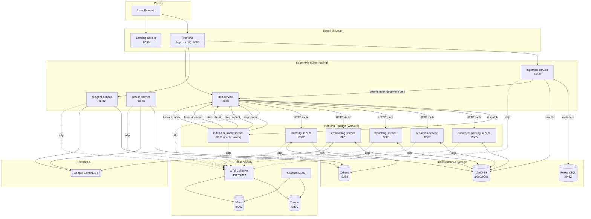
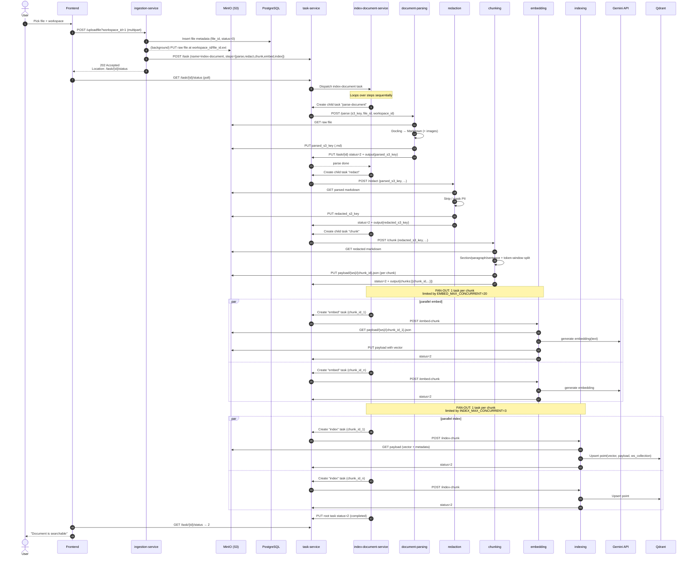
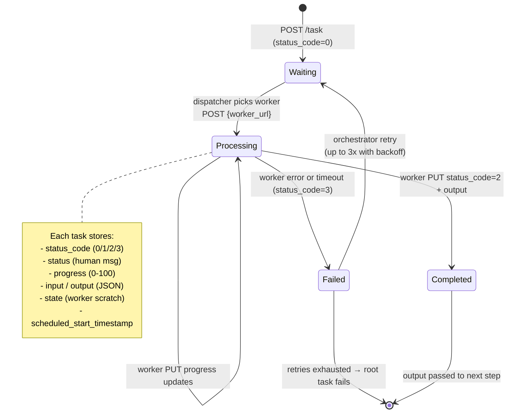
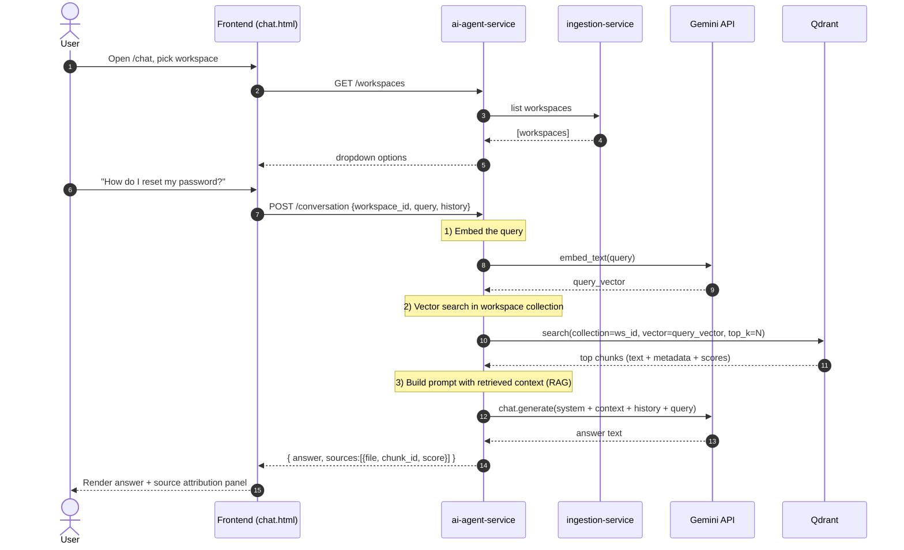
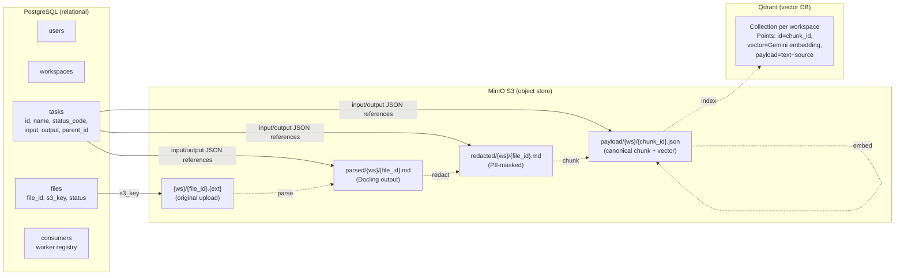
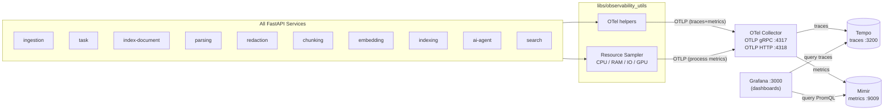

# QuickResolve – Architecture & Pipeline

This document describes the end-to-end architecture of QuickResolve through a series of Mermaid diagrams. Each diagram focuses on a different concern: system topology, ingestion pipeline, task orchestration, query path, storage, observability, and deployment.

---

## 1. High-Level System Architecture

This shows every container in the platform and how they interconnect. The user enters through the Frontend / Landing page; the backend is split into "edge" services (talked to by clients), "pipeline" services (background processing), shared infrastructure, and observability.

Key idea: clients only talk to four "edge" services. The pipeline services never touch a browser — they are workers driven by `task-service`.

---

## 2. Document Upload & Indexing Pipeline (Sequence)

This shows the full life of one PDF/DOCX from upload to a searchable vector. The trick of the design is that `ingestion-service` returns immediately with a `202 + Location` header; everything else happens asynchronously, orchestrated by `index-document-service`.

Notable details from the code:

- `ingestion-service` skips the `parse-document` step for `.md` uploads.
- Each step is retried up to 3× by `index-document-service` with backoff before the root task is marked failed.
- All inter-service URLs come from `task-service/registry.py` — services don't call each other directly; they all go through `task-service`.

---

## 3. Task Orchestration State Machine

Every step of the pipeline (and the root indexing job itself) is a row in PostgreSQL managed by `task-service`. This is the lifecycle every task moves through.

---

## 4. AI Chat / Search Query Flow

This is the second major workflow: once documents are indexed, the user can ask natural-language questions. This path is entirely synchronous and bypasses the task system.

The dedicated `search-service` (port 8003) offers the same vector-search step without the LLM generation, for raw "Search" UI queries.

---

## 5. Storage / Data Architecture

QuickResolve uses three different stores, each for a specific purpose. Understanding what lives where is key to debugging.

Why this layout works:

- PostgreSQL is the source of truth for *what exists* (files, users, task states).
- MinIO is the source of truth for *artifact content* at every stage of processing.
- Qdrant is the search index — derivable, can be rebuilt from MinIO payloads if lost.

---

## 6. Observability Stack (OpenTelemetry)

Every service is instrumented with OpenTelemetry SDK. The OTel Collector is the single fan-in point that splits traces vs metrics to two specialized backends, both visualized in Grafana.

Toggled per service via `OTEL_SDK_DISABLED` / `OTEL_METRICS_ENABLED` (default off to minimize overhead).

---

## 7. Container / Deployment Topology (docker-compose)

Logical view of how the 17 containers in `docker-compose.yml` are wired together over the default Docker bridge network, and which ports are exposed to the host.

```mermaid
graph TB
    subgraph Host["Host Machine (localhost ports)"]
        direction TB
        h8080[":8080 frontend"]
        h8090[":8090 landing"]
        h8000[":8000 ingestion"]
        h8001[":8001 embedding"]
        h8002[":8002 ai-agent"]
        h8003[":8003 search"]
        h8005[":8005 parsing"]
        h8006[":8006 chunking"]
        h8007[":8007 redaction"]
        h8010[":8010 task"]
        h8011[":8011 index-document"]
        h8012[":8012 indexing"]
        h5432[":5432 postgres"]
        h6333[":6333 qdrant"]
        h9000[":9000 minio API"]
        h9001[":9001 minio console"]
        h3000[":3000 grafana"]
        h3200[":3200 tempo"]
        h9009[":9009 mimir"]
        h4317[":4317/4318 otel"]
    end

    subgraph Net["Docker network: quickresolve_default"]
        direction TB
        c_fe[frontend]
        c_lp[landing-next]
        c_ing[ingestion-service]
        c_emb[embedding-service]
        c_ag[ai-agent-service]
        c_sr[search-service]
        c_pr[document-parsing-service]
        c_ck[chunking-service]
        c_rd[redaction-service]
        c_ts[task-service]
        c_idx[index-document-service]
        c_ix[indexing-service]
        c_db[(db / postgres)]
        c_qd[(qdrant)]
        c_s3[(minio)]
        c_otc[otel-collector]
        c_tp[(tempo)]
        c_mi[(mimir)]
        c_gf[grafana]
        c_dg[data-generator<br/>profile=generate-data]
    end

    h8080 --- c_fe
    h8090 --- c_lp
    h8000 --- c_ing
    h8001 --- c_emb
    h8002 --- c_ag
    h8003 --- c_sr
    h8005 --- c_pr
    h8006 --- c_ck
    h8007 --- c_rd
    h8010 --- c_ts
    h8011 --- c_idx
    h8012 --- c_ix
    h5432 --- c_db
    h6333 --- c_qd
    h9000 --- c_s3
    h9001 --- c_s3
    h3000 --- c_gf
    h3200 --- c_tp
    h9009 --- c_mi
    h4317 --- c_otc

    c_ing --> c_db
    c_ing --> c_s3
    c_ing --> c_ts
    c_ts --> c_db
    c_ts --> c_idx
    c_ts --> c_pr
    c_ts --> c_rd
    c_ts --> c_ck
    c_ts --> c_emb
    c_ts --> c_ix
    c_idx --> c_ts
    c_pr --> c_s3
    c_rd --> c_s3
    c_ck --> c_s3
    c_emb --> c_s3
    c_ix --> c_s3
    c_ix --> c_qd
    c_ag --> c_qd
    c_sr --> c_qd

    c_ing -. otlp .-> c_otc
    c_ts -. otlp .-> c_otc
    c_idx -. otlp .-> c_otc
    c_pr -. otlp .-> c_otc
    c_rd -. otlp .-> c_otc
    c_ck -. otlp .-> c_otc
    c_emb -. otlp .-> c_otc
    c_ix -. otlp .-> c_otc
    c_ag -. otlp .-> c_otc
    c_sr -. otlp .-> c_otc
    c_otc --> c_tp
    c_otc --> c_mi
    c_gf --> c_tp
    c_gf --> c_mi
```

---

## End-to-End Workflow Summary

Putting it all together, here is the **whole workflow** in two phases.

### Phase A — Indexing (write path)

1. **Upload** — User selects a file in the Frontend (`:8080`). Frontend posts it to `ingestion-service` (`:8000`).
2. **Persist + Schedule** — `ingestion-service` writes file metadata to PostgreSQL, asynchronously uploads the raw bytes to MinIO at `{workspace_id}/{file_id}.ext`, and creates an `index-document` task in `task-service` (`:8010`).
3. **Immediate response** — `ingestion-service` returns `202 Accepted` with a `Location` header pointing to the task status URL. The browser starts polling.
4. **Orchestration** — `task-service` dispatches the root task to `index-document-service` (`:8011`), which iterates the step list (`parse → redact → chunk → embed → index`).
5. **Sequential steps** — For each step, the orchestrator creates a child task. `task-service` looks up the worker URL in its registry and POSTs to it. Each worker reads its input from MinIO, does its work, writes output back to MinIO, and updates the task's `status_code` to `2` (success) or `3` (failure) with optional retry.
6. **Fan-out** — The `embed` and `index` steps are special: the orchestrator creates **one task per chunk** and runs them in parallel under a semaphore (`EMBED_MAX_CONCURRENT=20`, `INDEX_MAX_CONCURRENT=3`). `embedding-service` calls Gemini for each chunk; `indexing-service` upserts each chunk's vector + payload into Qdrant.
7. **Done** — Once every fan-out task succeeds, `index-document-service` marks the root task `status_code=2`. The browser's poll sees this and tells the user the document is searchable.

### Phase B — Query (read path)

1. **Open chat** — User opens `/chat`, picks a workspace.
2. **Conversation** — Question goes to `ai-agent-service` (`:8002`).
3. **Embed query** — Agent asks Gemini to embed the user's question.
4. **Retrieve** — Agent searches Qdrant in the workspace's collection, gets top-K chunks with their text and source metadata.
5. **Generate** — Agent builds a RAG prompt (system prompt + retrieved chunks + chat history + user query) and asks Gemini to generate the final answer.
6. **Return + cite** — Agent returns the answer plus the source list. The Frontend renders the answer and shows the source documents in the sidebar for traceability.

Throughout both phases, every service emits OTel traces and metrics to the OTel Collector, which routes them to Tempo (traces) and Mimir (metrics), both visualized in Grafana (`:3000`) using the dashboards under `observability/`.
